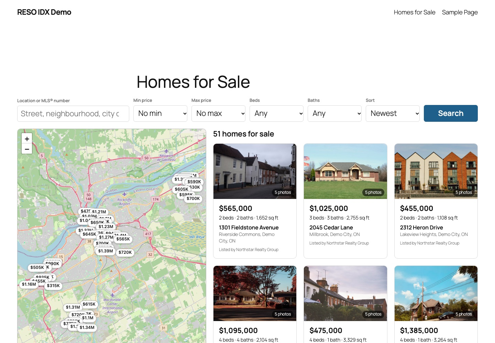
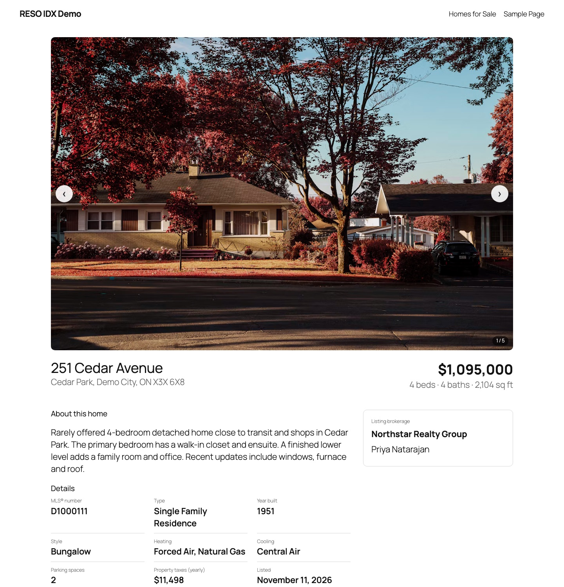
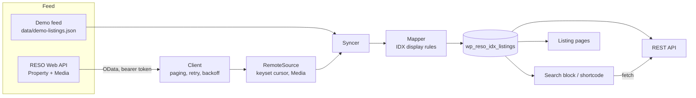

# RESO IDX for WordPress

[](https://github.com/mertmetin/reso-idx/actions/workflows/ci.yml)


A WordPress plugin that syncs MLS® listings from any **RESO Web API** (OData) feed into WordPress and shows them with a search block, a map and SEO-friendly listing pages. It follows the board's IDX display rules for you.

**[▶ Try the live demo in WordPress Playground](https://playground.wordpress.net/?blueprint-url=https://raw.githubusercontent.com/mertmetin/reso-idx/main/blueprint.json)**: it runs in your browser with 60 fictional listings, and you don't need an MLS account.



I'm a REALTOR® and a developer. I built the IDX search for my own brokerage site, and this plugin is a clean, general version of that work, for any board that offers a RESO Web API. It has been run against a live Ontario feed (PropTx): about 3,400 active Ottawa listings with photos imported in roughly three minutes.

## Features

- **Incremental sync from any RESO Web API server.** It uses bearer-token auth, follows `@odata.nextLink` (or `$skip`), retries `429`/`5xx` with backoff and honours `Retry-After`. It runs on WP-Cron in short batches that pick up where the last run stopped.
- **Requests only fields the server has.** *Test connection* reads the server's `$metadata`, and the plugin requests only fields that exist there. MLS systems differ (`LivingArea` vs `LivingAreaRange`, `Heating` vs `HeatType`), and asking for an unknown field fails the whole request.
- **IDX rules built in:**
  - Listings with `InternetEntireListingDisplayYN = false` are never stored.
  - When `InternetAddressDisplayYN = false`, the street, postal code and map pin are hidden.
  - Only the statuses you allow are shown (Active by default); anything else is removed on the next sync.
  - The listing brokerage is shown on every card and listing page.
  - A configurable disclaimer and a "last updated" time appear wherever listings do.
  - Only photos marked public and active are used.
- **Listing Search block** (and a `[reso_idx_search]` shortcode):
  - Price, beds, baths, type, sort and free-text filters.
  - Leaflet/OpenStreetMap pins with "search as I move the map".
  - Results update in place, and the URL stays shareable.
  - Results are rendered on the server, so the block works without JavaScript and search engines see the listings.
- **Listing pages** at `/listing/{key}/{address}/`, with a photo gallery, details, a map, a canonical URL, Open Graph tags and `schema.org/RealEstateListing` JSON-LD. They work in both classic and block themes.
- **REST API**: `GET /wp-json/reso-idx/v1/listings` and `/listings/{key}`.
- **WP-CLI**: `wp reso-idx sync --all`, `reconcile`, `test-connection` and `status`.
- **Demo feed**: 60 fictional listings in RESO format, each with its own photo set (exterior, kitchen, living room, bedroom, bathroom), that go through the same sync code as a real feed.



## How it works



A few design decisions worth calling out:

- **Keyset sync cursor.** The sync position is the last record's `(ModificationTimestamp, ListingKey)`, not just a timestamp. MLS systems often update hundreds of listings with the same timestamp. A cursor that stores only the time either skips some of those listings or reads them forever. The source asks for `ModificationTimestamp ge T`, drops the records the cursor already covers, and reads a timestamp group in full when it is bigger than a page. Timestamps are compared to the microsecond.
- **A batch is only "done" when it's empty.** A short batch can still be followed by more changes, because the source drops records it has already seen. (A test covers this; it was a real bug found against the live feed.)
- **Changes are fetched in every status,** so a listing that sells is removed on the next sync. A daily *reconcile* also removes listings that disappeared from the feed with no status change, which is common when a brokerage opts out of IDX. If the feed suddenly reports fewer than half the stored listings, reconcile refuses to run, so a broken feed can't empty your site.
- **Listings get their own indexed table** instead of posts and post meta. Price, bedroom and map-bounds queries over thousands of rows stay fast, and a sync doesn't touch `wp_posts`.
- **The sync logic doesn't depend on WordPress.** `Syncer`, `Mapper`, `RemoteSource`, `Client` and `SearchCriteria` take interfaces (`Source`, `ListingStore`, `Transport`), so they're unit-tested without loading WordPress.
- **One card template.** The REST API can return the rendered results HTML (`render=1`). Cards on the first page load and after a filter change come from the same PHP template, and themes can override it.

## Install

1. Download the plugin from GitHub (Code → Download ZIP) and upload it under **Plugins → Add New → Upload**. It has no Composer dependencies at runtime.
2. Activate it. The demo feed loads right away.
3. Add the **Listing Search** block to a page, or use `[reso_idx_search]`.

### Connect your MLS feed

You need RESO Web API access from your board or MLS. That's usually an IDX agreement that comes with a token.

1. Go to **Settings → RESO IDX** and choose *RESO Web API server*.
2. Enter the endpoint (the OData service root) and the token.
   - To keep the token out of the database, put it in `wp-config.php` instead: `define( 'RESO_IDX_TOKEN', '…' );`
3. Optionally add a scope filter that limits the feed to your area, then click **Test connection**.
4. Run the first import from the command line, then let WP-Cron keep it up to date:

```bash
wp reso-idx sync --all
```

Example settings for Ontario's PropTx feed:

| Setting | Value |
| --- | --- |
| Endpoint | `https://query.ampre.ca/odata/` |
| Scope filter | `CountyOrParish eq 'Ottawa' and TransactionType eq 'For Sale'` |
| Media filter | `ImageSizeDescription eq 'Large' and MediaCategory eq 'Photo'` |

### Maps for feeds without coordinates

Some feeds, including PropTx IDX, send no `Latitude`/`Longitude`. The plugin doesn't bundle a geocoder, because bulk use of free geocoding services breaks their terms. Instead, plug in your own with a filter:

```php
add_filter( 'reso_idx_geocode', function ( $point, array $listing ) {
	// Return [ lat, lng ] or null. Called once per listing; the result is stored.
	return my_geocoder( "{$listing['address']}, {$listing['city']} {$listing['postal_code']}" );
}, 10, 2 );
```

Listings with a withheld address are never geocoded. Until at least one listing has coordinates, the search block hides its map.

## Customise

- **Templates:** copy any file from `templates/` to `your-theme/reso-idx/` to override it (`card.php`, `results.php`, `search.php`, `listing.php`, `listing-page.php`, `disclaimer.php`).
- **Styles:** the CSS uses your theme's fonts and colours. Change the accent with `:root { --reso-idx-accent: #b5523b; }`.
- **Hooks:**

| Hook | Use |
| --- | --- |
| `reso_idx_geocode` (filter) | Coordinates for listings the feed sends without them |
| `reso_idx_listing_aside` (action) | Add a contact form or call to action next to a listing |
| `reso_idx_currency_symbol`, `reso_idx_currency` (filters) | Price formatting and the JSON-LD currency (default `$` / `CAD`) |
| `reso_idx_user_agent` (filter) | User-Agent for feed requests |
| `reso_idx_leaflet_url` (filter) | Self-host Leaflet instead of loading it from unpkg (with SRI) |

## REST API

```
GET /wp-json/reso-idx/v1/listings?q=maple&min_price=400000&beds=3&sort=price_asc&page=2
GET /wp-json/reso-idx/v1/listings?bounds=45.30,-75.85,45.48,-75.60
GET /wp-json/reso-idx/v1/listings/{key}
```

Responses include `X-WP-Total` and `X-WP-TotalPages` headers. Listings with a withheld address return `null` for `address`, `postal_code` and the coordinates.

## Development

```bash
composer install
composer check          # PHPCS (WordPress-Extra), PHPStan level 6, PHPUnit
tests/e2e/smoke.sh      # boots WordPress in Playground (PHP + SQLite) and checks the demo end to end
composer demo-data      # regenerate data/demo-listings.json (seeded, so the output is reproducible)
```

CI runs the unit tests on PHP 8.1–8.4, the lint checks, and the Playground smoke test on every push.

```
reso-idx.php            plugin header and bootstrap
src/Api/                OData query builder, HTTP client, $metadata reader
src/Sync/               Source interface, RemoteSource, DemoSource, Syncer, Mapper, WP-Cron service
src/Storage/            table schema, repository, validated search criteria
src/Frontend/           search block, listing pages, assets, view helpers
src/Rest/  src/Admin/  src/Cli/
templates/              theme-overridable templates
blocks/listing-search/  block.json and editor script (no build step)
tests/Unit/             PHPUnit tests (no WordPress needed)
tests/e2e/              Playground smoke test
```

## Data and licensing

- Every listing, address, brokerage and agent in the demo feed is fictional. Its photos come from [Unsplash](https://unsplash.com/license) and are loaded from Unsplash's servers; the photographers are credited in [docs/demo-photo-credits.md](docs/demo-photo-credits.md).
- With a real feed, each listing shows its own photos from the MLS, filtered to the ones marked public and active.
- The plugin itself contains no MLS data.
- You are responsible for following your board's IDX rules on the site where you use it.

GPL-2.0-or-later. MLS® is a trademark of The Canadian Real Estate Association; RESO® is a trademark of the Real Estate Standards Organization. This project isn't affiliated with either.
